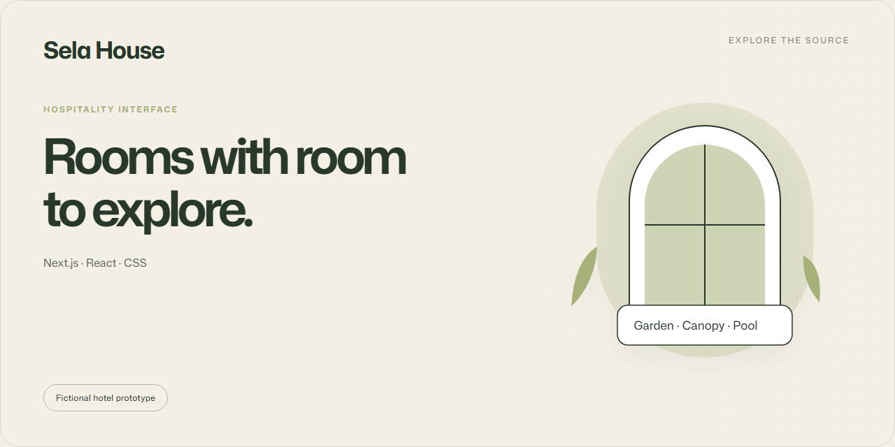

# Sela House

A fictional hotel experience with horizontal navigation, room galleries and an interactive stay planner.

**Next.js · React · CSS** · Fictional hotel prototype

## Inside the experience

- Horizontal navigation with mouse, trackpad, touch and keyboard.
- Room filters, saved selections, galleries and related-room suggestions.
- Garden, Canopy and Pool detail pages with a simulated stay planner.
- Responsive layouts, visible focus and reduced-motion support.

## Run locally

Use a current supported Node.js release; Node.js 24 is a suitable baseline.

```sh
git clone https://github.com/EGYYFZA/Room-Explorer.git
cd Room-Explorer
npm ci
npm run dev
```

Open **http://127.0.0.1:3000**. On PowerShell, use <code>npm.cmd</code> if script execution is restricted.

```sh
npm run build
npm run preview
npm test
```

The build exports the site to <code>out/</code> and creates directly openable HTML
pages. Edit the source rather than generated HTML.

## Source map

| Path | Purpose |
| :-- | :-- |
| [app/](app/) | Pages, routes and metadata |
| [components/](components/) | Journey and room interfaces |
| [lib/](lib/) | Shared content and browser interactions |
| [styles/](styles/) | Layout, transitions and motion |
| [tests/](tests/) | Browser regression checks |

## Scope and credits

Sela House, its rooms and prices are fictional. Bookings and payments are not
connected to a backend. Photography is illustrative; see [image credits](public/media/credits.txt).
The visual composition takes inspiration from [Art Estates](https://www.artestates.co/).
